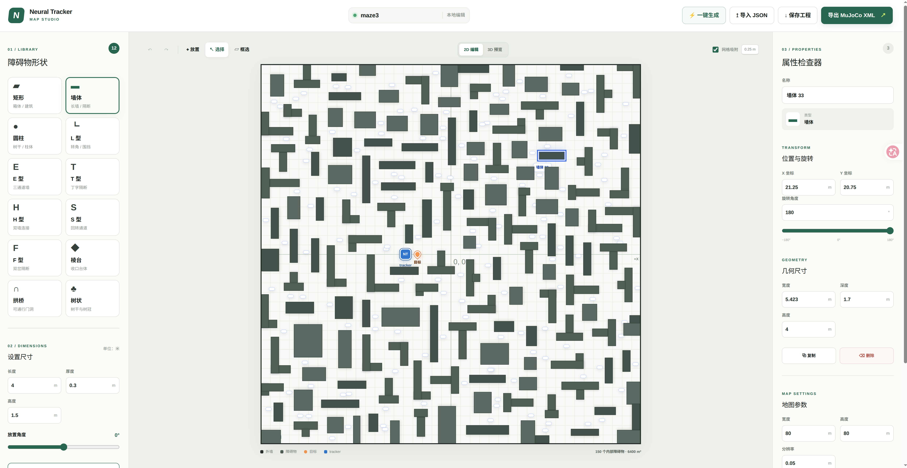
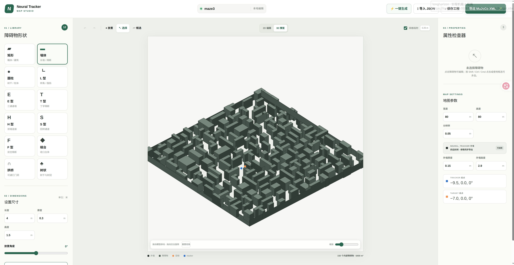

# Map Editor

浏览器中的可视化地图编辑器。手动绘制或随机生成障碍物地图，预览效果后导出为 JSON，也可导入已有 JSON 继续编辑。

## 功能

- 支持矩形、墙体、圆柱、组合墙、棱台、拱桥和树状等 12 种障碍物。
- 随机生成地图，可设置各类障碍物的数量、尺寸和间距，并检查重叠。
- 拖动、旋转、框选、批量复制与删除，支持网格吸附和撤销/重做。
- 切换 2D 编辑与 3D 预览，自定义地图尺寸、分辨率和外墙参数。
- 导入/导出 JSON，编辑内容自动保存在当前浏览器中。

## 预览

**2D 编辑**



**3D 预览**



## 本地运行

需要 Node.js **22.13.0 或更新版本**。

```bash
git clone https://github.com/Bling-sun/map_editor.git
cd map_editor
npm ci
npm run dev
```

浏览器打开 <http://localhost:3000>。

## 使用

1. 设置地图宽高、分辨率和外墙参数。
2. 选择形状并放置障碍物，或点击「一键生成」随机生成地图。
3. 在 2D / 3D 视图中调整位置、角度和尺寸。
4. 点击「保存工程」下载 JSON；点击「导入 JSON」可继续编辑。

JSON 包含地图参数、外墙、标记点以及各障碍物的形状、位置、角度和尺寸。长度单位为米，角度单位为度；地图中心为原点，X 轴向右，Y 轴向上。
